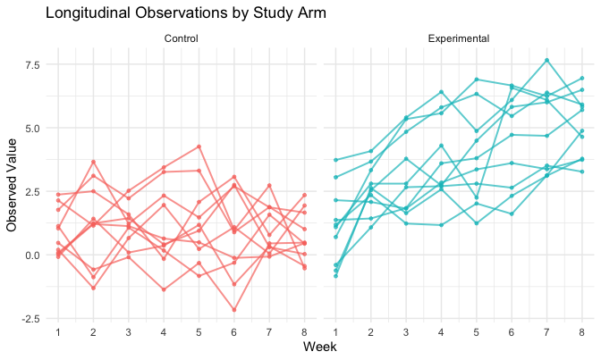
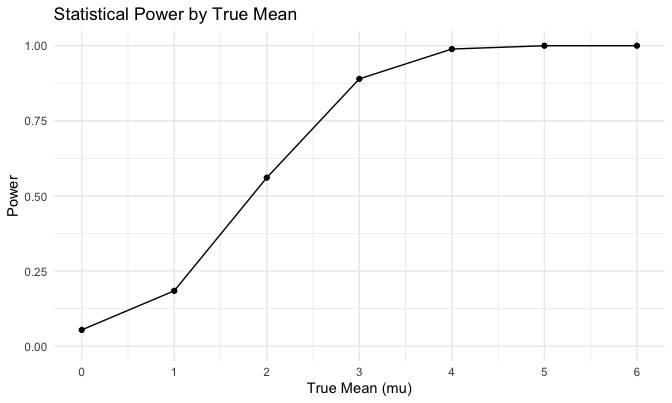
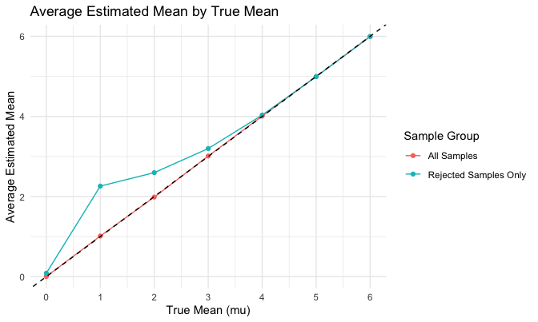

Homework 5
================
Yiman Rui
2026-11-16

## Problem 1

``` r
# Birthday function from class
birthday_repeated = function(n_room){
  birthdays = sample(1:365, size = n_room, replace = TRUE)
  
  repeated_birthdays = length(unique(birthdays)) < n_room
  
  return(repeated_birthdays)
}
```

``` r
birthday_results_df = 
  expand_grid(
    number_of_people = 2:50,
    iter = 1:10000
  ) |> 
  mutate(
    repeated = map_lgl(number_of_people, birthday_repeated)
  )

birthday_prob_df =
  birthday_results_df |>
  group_by(number_of_people) |>
  summarize(
    prob_of_repeat = mean(repeated)
  )

birthday_prob_df
```

    ## # A tibble: 49 × 2
    ##    number_of_people prob_of_repeat
    ##               <int>          <dbl>
    ##  1                2         0.0042
    ##  2                3         0.0063
    ##  3                4         0.0165
    ##  4                5         0.0271
    ##  5                6         0.0418
    ##  6                7         0.0524
    ##  7                8         0.0777
    ##  8                9         0.0985
    ##  9               10         0.120 
    ## 10               11         0.141 
    ## # ℹ 39 more rows

Plot

``` r
birthday_prob_df |> 
  ggplot(aes(x = number_of_people, y = prob_of_repeat)) +
  geom_point() +
  geom_line() +
  labs(
    title = "Probability of Sharing a Birthday by Group Size",
    x = "Number of People in the Room",
    y = "Probability of Shared Birthday"
  ) +
  theme_minimal()
```


The probability that at least two people share a birthday increases with
group size. With around 23 people, the probability exceeds 50%, and it
reaches approximately 97% with 50 people. The increase is nonlinear and
gradually levels off as the probability approaches 1.

## Problem 2

``` r
trial_files = tibble(
  file_name = list.files(
    path = "data",
    pattern = "\\.csv$",
    full.names = TRUE,
    recursive = TRUE
  )
)

trial_df = trial_files |>
  mutate(
    subject = str_remove(basename(file_name), "\\.csv$"),
    arm = case_when(
      str_detect(subject, "^con_") ~ "Control",
      str_detect(subject, "^exp_") ~ "Experimental"
    ),
    subject_id = str_remove(subject, "^(con|exp)_"),
    measurements = purrr::map(
      file_name,
      ~read_csv(.x, show_col_types = FALSE)
    )
  ) |>
  select(subject_id, arm, measurements) |>
  unnest(cols = measurements) |>
  pivot_longer(
    cols = starts_with("week_"),
    names_to = "week",
    names_prefix = "week_",
    values_to = "observation"
  ) |>
  mutate(week = as.integer(week)) |>
  arrange(arm, subject_id, week)

head(trial_df)
```

    ## # A tibble: 6 × 4
    ##   subject_id arm      week observation
    ##   <chr>      <chr>   <int>       <dbl>
    ## 1 01         Control     1        0.2 
    ## 2 01         Control     2       -1.31
    ## 3 01         Control     3        0.66
    ## 4 01         Control     4        1.96
    ## 5 01         Control     5        0.23
    ## 6 01         Control     6        1.09

``` r
trial_df |>
  distinct(arm, subject_id) |>
  count(arm)
```

    ## # A tibble: 2 × 2
    ##   arm              n
    ##   <chr>        <int>
    ## 1 Control         10
    ## 2 Experimental    10

``` r
trial_df |>
  filter(week %in% c(1, 8)) |>
  group_by(arm, week) |>
  summarize(
    mean_observation = mean(observation),
    .groups = "drop"
  )
```

    ## # A tibble: 4 × 3
    ##   arm           week mean_observation
    ##   <chr>        <int>            <dbl>
    ## 1 Control          1            0.915
    ## 2 Control          8            0.74 
    ## 3 Experimental     1            1.14 
    ## 4 Experimental     8            5.12

Spaghetti plot

``` r
trial_df |>
  ggplot(
    aes(
      x = week,
      y = observation,
      group = interaction(arm, subject_id),
      color = arm
    )
  ) +
  geom_line(alpha = 0.7, linewidth = 0.7) +
  geom_point(alpha = 0.7, size = 1) +
  facet_wrap(~arm) +
  scale_x_continuous(breaks = 1:8) +
  labs(
    title = "Longitudinal Observations by Study Arm",
    x = "Week",
    y = "Observed Value"
  ) +
  theme_minimal() +
  theme(legend.position = "none")
```


The spaghetti plot shows different trends between the two groups over
eight weeks. The control group remains relatively stable, with its mean
observation decreasing slightly from 0.92 to 0.74. In contrast, the
experimental group shows an increasing trend, with the mean rising from
1.14 to 5.12. Although individual observations vary, the experimental
group generally shows greater increases over time.

## Problem 3

Function

``` r
set.seed(2026)

sim_ttest = function(mu, n_obs = 30, sigma = 5) {

  sim_df =
    tibble(
      x = rnorm(n = n_obs, mean = mu, sd = sigma)
    )

  ttest_result =
    t.test(sim_df$x, mu = 0)

  return_df =
    broom::tidy(ttest_result) |>
    select(estimate, p.value) |>
    rename(
      mu_hat = estimate,
      p_value = p.value
    )

  return(return_df)
}
```

Simulations

``` r
set.seed(1236)

sim_results_df =
  expand_grid(
    mu = 0:6,
    iter = 1:5000
  ) |>
  mutate(
    results = map(mu, sim_ttest)
  ) |>
  unnest(results)

sim_summary_df =
  sim_results_df |>
  group_by(mu) |>
  summarize(
    power = mean(p_value < 0.05),
    mean_mu_hat = mean(mu_hat),
    mean_mu_hat_rejected = mean(mu_hat[p_value < 0.05])
  )

sim_summary_df
```

    ## # A tibble: 7 × 4
    ##      mu  power mean_mu_hat mean_mu_hat_rejected
    ##   <int>  <dbl>       <dbl>                <dbl>
    ## 1     0 0.0536     0.00452               0.0867
    ## 2     1 0.184      1.01                  2.26  
    ## 3     2 0.561      1.99                  2.60  
    ## 4     3 0.890      3.01                  3.20  
    ## 5     4 0.989      4.01                  4.04  
    ## 6     5 1          5.00                  5.00  
    ## 7     6 1          6.00                  6.00

Plots

``` r
sim_summary_df |>
  ggplot(aes(x = mu, y = power)) +
  geom_point() +
  geom_line() +
  labs(
    title = "Statistical Power by True Mean",
    x = "True Mean (mu)",
    y = "Power"
  ) +
  scale_x_continuous(breaks = 0:6) +
  scale_y_continuous(limits = c(0, 1)) +
  theme_minimal()
```



Statistical power increases as the true mean increases. When $\mu$ = 0,
the rejection rate is approximately 5.36%, while power increases to
56.06% at $\mu$ = 2 and reaches 100% at $\mu$ = 5. This suggests that
larger effect sizes make it easier to reject the null hypothesis.

``` r
sim_summary_df |>
  select(mu, mean_mu_hat, mean_mu_hat_rejected) |>
  pivot_longer(
    mean_mu_hat:mean_mu_hat_rejected,
    names_to = "estimate_type",
    values_to = "average_estimate"
  ) |>
  mutate(
    estimate_type = recode(
      estimate_type,
      mean_mu_hat = "All Samples",
      mean_mu_hat_rejected = "Rejected Samples Only"
    )
  ) |>
  ggplot(aes(x = mu, y = average_estimate, color = estimate_type)) +
  geom_point() +
  geom_line() +
  geom_abline(
    intercept = 0,
    slope = 1,
    linetype = "dashed"
  ) +
  labs(
    title = "Average Estimated Mean by True Mean",
    x = "True Mean (mu)",
    y = "Average Estimated Mean",
    color = "Sample Group"
  ) +
  scale_x_continuous(breaks = 0:6) +
  theme_minimal()
```



The average estimated mean across all samples is approximately equal to
the true mean. However, among samples where the null hypothesis is
rejected, the average estimate tends to be larger than the true mean,
especially for smaller positive effect sizes. For example, when $\mu$ =
1, the average estimate among rejected samples is 2.26. This occurs
because samples with more extreme estimates are more likely to produce
significant results. As power increases, the difference becomes smaller,
and the average estimate approaches the true mean.
