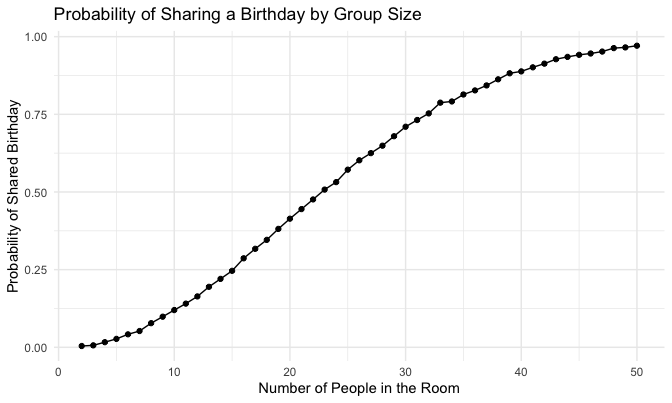

Homework 5
================
Yiman Rui
2026-11-16

## Problem 1

``` r
# Birthday function from class
birthday_repeated = function(n_room){
  birthdays = sample(1:365, size = n_room, replace = TRUE)
  
  repeated_birthdays = length(unique(birthdays)) < n_room
  
  return(repeated_birthdays)
}
```

``` r
birthday_results_df = 
  expand_grid(
    number_of_people = 2:50,
    iter = 1:10000
  ) |> 
  mutate(
    repeated = map_lgl(number_of_people, birthday_repeated)
  )

birthday_prob_df =
  birthday_results_df |>
  group_by(number_of_people) |>
  summarize(
    prob_of_repeat = mean(repeated)
  )

birthday_prob_df
```

    ## # A tibble: 49 × 2
    ##    number_of_people prob_of_repeat
    ##               <int>          <dbl>
    ##  1                2         0.0042
    ##  2                3         0.0063
    ##  3                4         0.0165
    ##  4                5         0.0271
    ##  5                6         0.0418
    ##  6                7         0.0524
    ##  7                8         0.0777
    ##  8                9         0.0985
    ##  9               10         0.120 
    ## 10               11         0.141 
    ## # ℹ 39 more rows

Plot

``` r
birthday_prob_df |> 
  ggplot(aes(x = number_of_people, y = prob_of_repeat)) +
  geom_point() +
  geom_line() +
  labs(
    title = "Probability of Sharing a Birthday by Group Size",
    x = "Number of People in the Room",
    y = "Probability of Shared Birthday"
  ) +
  theme_minimal()
```



The probability of sharing a birthday increases as the number of people
in the room increases. With around 23 people, the probability exceeds
50%, and it reaches approximately 97% with 50 people. The increase is
nonlinear and gradually levels off as the probability approaches 1.

## Problem 2

``` r
trial_files = tibble(
  file_name = list.files(
    path = "data",
    pattern = "\\.csv$",
    full.names = TRUE,
    recursive = TRUE
  )
)

trial_df = trial_files |>
  mutate(
    subject = str_remove(basename(file_name), "\\.csv$"),
    arm = case_when(
      str_detect(subject, "^con_") ~ "Control",
      str_detect(subject, "^exp_") ~ "Experimental"
    ),
    subject_id = str_remove(subject, "^(con|exp)_"),
    measurements = purrr::map(
      file_name,
      ~read_csv(.x, show_col_types = FALSE)
    )
  ) |>
  select(subject_id, arm, measurements) |>
  unnest(cols = measurements) |>
  pivot_longer(
    cols = starts_with("week_"),
    names_to = "week",
    names_prefix = "week_",
    values_to = "observation"
  ) |>
  mutate(week = as.integer(week)) |>
  arrange(arm, subject_id, week)

head(trial_df)
```

    ## # A tibble: 6 × 4
    ##   subject_id arm      week observation
    ##   <chr>      <chr>   <int>       <dbl>
    ## 1 01         Control     1        0.2 
    ## 2 01         Control     2       -1.31
    ## 3 01         Control     3        0.66
    ## 4 01         Control     4        1.96
    ## 5 01         Control     5        0.23
    ## 6 01         Control     6        1.09

``` r
trial_df |>
  count(arm)
```

    ## # A tibble: 2 × 2
    ##   arm              n
    ##   <chr>        <int>
    ## 1 Control         80
    ## 2 Experimental    80

``` r
trial_df |>
  group_by(arm, week) |>
  summarize(
    mean_observation = mean(observation),
    .groups = "drop"
  )
```

    ## # A tibble: 16 × 3
    ##    arm           week mean_observation
    ##    <chr>        <int>            <dbl>
    ##  1 Control          1            0.915
    ##  2 Control          2            1.15 
    ##  3 Control          3            1.18 
    ##  4 Control          4            1.10 
    ##  5 Control          5            1.28 
    ##  6 Control          6            0.771
    ##  7 Control          7            0.99 
    ##  8 Control          8            0.74 
    ##  9 Experimental     1            1.14 
    ## 10 Experimental     2            2.60 
    ## 11 Experimental     3            3.14 
    ## 12 Experimental     4            3.77 
    ## 13 Experimental     5            3.81 
    ## 14 Experimental     6            4.55 
    ## 15 Experimental     7            5.02 
    ## 16 Experimental     8            5.12

Spaghetti plot

``` r
trial_df |>
  ggplot(
    aes(
      x = week,
      y = observation,
      group = interaction(arm, subject_id),
      color = arm
    )
  ) +
  geom_line(alpha = 0.7, linewidth = 0.7) +
  geom_point(alpha = 0.7, size = 1) +
  facet_wrap(~arm) +
  scale_x_continuous(breaks = 1:8) +
  labs(
    title = "Longitudinal Observations by Study Arm",
    x = "Week",
    y = "Observed Value"
  ) +
  theme_minimal() +
  theme(legend.position = "none")
```


The spaghetti plot shows different trends between the control and
experimental groups over the eight weeks. The control group remains
relatively stable, with some fluctuations among individual participants.
Its mean observation decreases slightly from 0.92 in week 1 to 0.74 in
week 8. In contrast, the experimental group shows a clear increasing
trend, with the mean observation rising from 1.14 to 5.12. Although
there is some variation between participants, the experimental group
generally has higher observed values over time, especially in the later
weeks.
